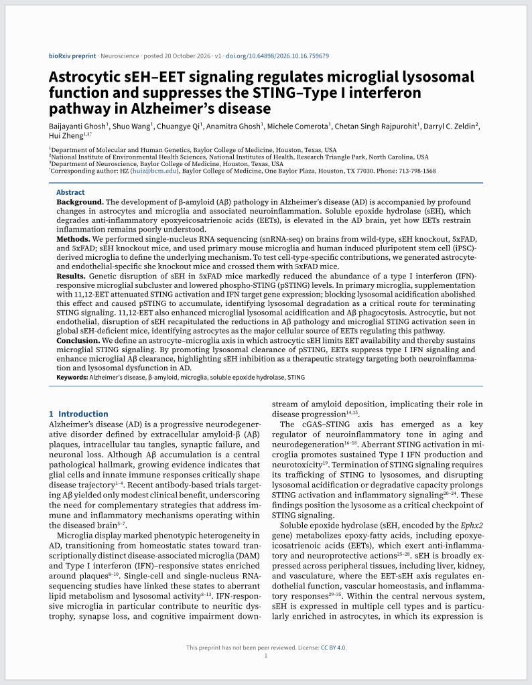
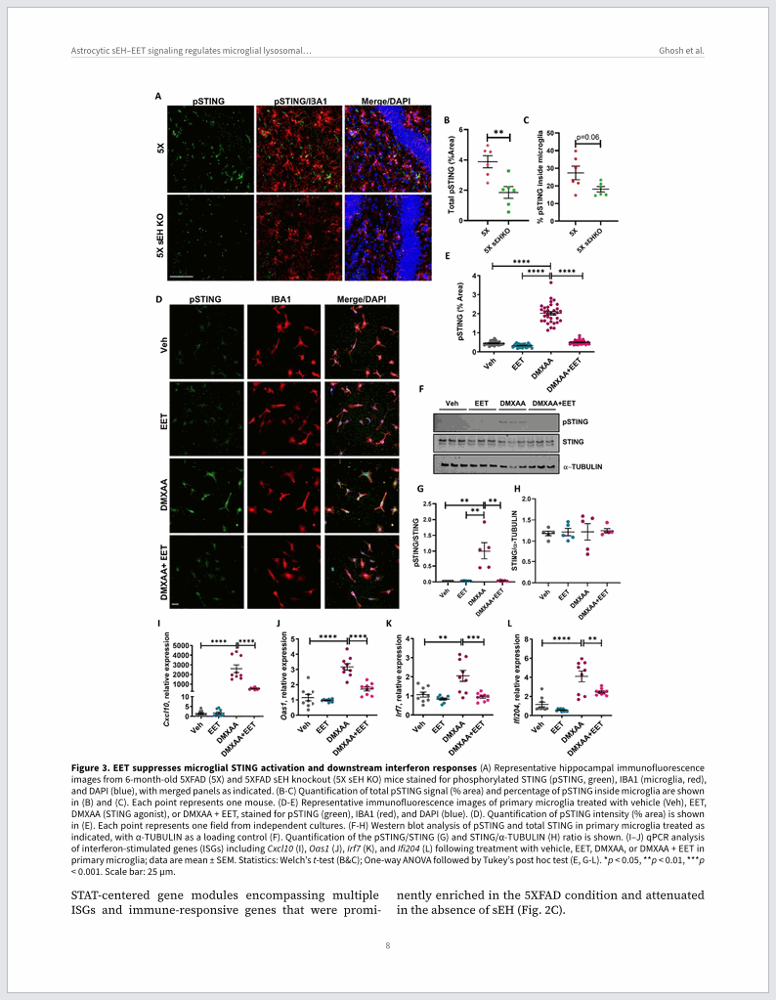
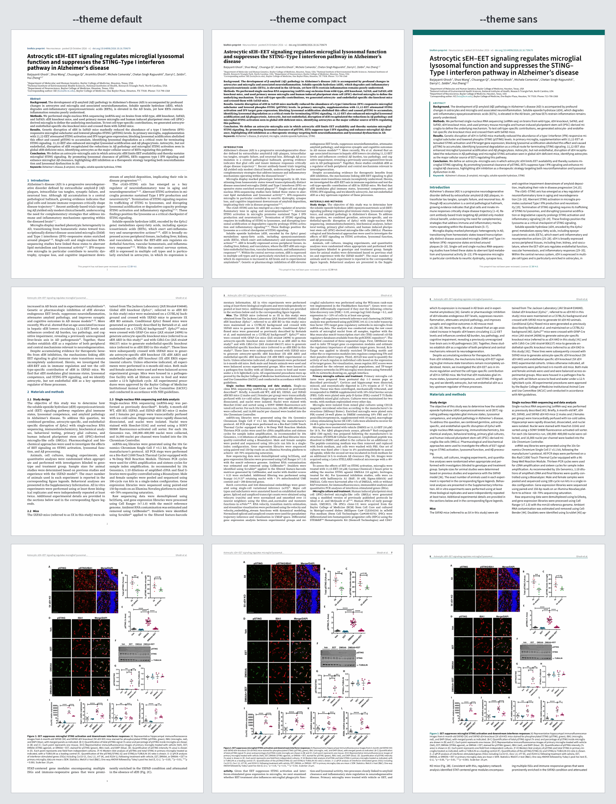

# rxiv2pdf

[](https://github.com/ali-zaeim/rxiv2pdf/actions/workflows/ci.yml)
[](https://pypi.org/project/rxiv2pdf/)
[](https://pypi.org/project/rxiv2pdf/)
[](https://github.com/ali-zaeim/rxiv2pdf/blob/main/LICENSE)

Turn a bioRxiv or medRxiv preprint into a two-column, journal-style PDF.

The PDF on bioRxiv and medRxiv is the authors' submitted manuscript, often double-spaced and
line-numbered, with the figures at the end. rxiv2pdf rebuilds the paper from the preprint's JATS
XML instead, with each figure placed after the text that first cites it and the citations linked
to the references.

```console
$ rxiv2pdf https://www.biorxiv.org/content/10.64898/2026.10.16.759679v1
PDF  2026.10.16.759679v1.pdf
```

| Page 1 | A figure page |
|:--:|:--:|
|  |  |

<sub>Screenshots on this page: Ghosh *et al.*, "Astrocytic sEH–EET signaling regulates microglial
lysosomal function and suppresses the STING–Type I interferon pathway in Alzheimer's disease",
bioRxiv [10.64898/2026.10.16.759679](https://doi.org/10.64898/2026.10.16.759679), CC BY 4.0.</sub>

## Install

Requires Python 3.11+. Typst comes with the `typst` Python package and the fonts are bundled, so
nothing else is needed.

```console
$ pipx install rxiv2pdf        # or: uv tool install rxiv2pdf
$ rxiv2pdf --help
```

`pip install rxiv2pdf` works too. To try it without installing anything:
`uvx rxiv2pdf 10.1101/2024.04.17.590000`.

## Usage

```console
$ rxiv2pdf 10.1101/2024.04.17.590000                  # bare DOI (bioRxiv by default, medRxiv tried next)
$ rxiv2pdf https://www.medrxiv.org/content/10.64898/2026.09.25.26364016v1.full
$ rxiv2pdf https://doi.org/10.64898/2026.10.22.760766 -o papers/ --theme compact --paper a4
$ rxiv2pdf 10.1101/2020.03.22.002386v2                # a specific version (default: latest)
$ rxiv2pdf --list dois.txt -o papers/                 # batch: one URL/DOI per line, # comments ok
```

All options are listed under [Options](#options).

## What you get

- **Front matter:** title, authors and affiliations, abstract, and a banner with the DOI, date and
  version. Page 1 notes that the preprint isn't peer reviewed and gives its license.
- **Two columns** with aligned baselines and a balanced last page.
- **Figures and tables** after their first citation, full width when wide, and sized by their
  lettering, so a simple chart isn't blown up. Long tables and figures after the references get
  pages of their own.
- **Linked citations,** collapsed into ranges, and DOI links in the references.
- **Equations, back matter** (funding, data availability…) and a banner on withdrawn preprints.

## Themes

Choose a look with `--theme`:

- `default`: serif body, numbered sans headings in navy, a shaded abstract box.
- `compact`: a dense letters-journal look, with smaller serif text on narrow margins, a serif title,
  a bold abstract, capitalised headings and run-in subheadings. About 20% fewer pages.
- `sans`: a modern open-access look, with a teal band, a large title, ragged-right sans text, ruled
  headings and bracketed citations.

One column per theme, each showing page 1, page 2 and a figure page of the same preprint:



## Options

| Option | Description |
|---|---|
| `-o, --outdir DIR` | Where the PDF goes. Default: the current directory. |
| `--preprint-version N` | Preprint version; overrides a `vN` in the URL. Default: the `vN` in the URL, else the latest. |
| `--server biorxiv\|medrxiv` | Override server detection. Default: detected from the URL; a bare DOI tries bioRxiv, then medRxiv. |
| `--theme default\|compact\|sans` | Look of the PDF; see [Themes](#themes). Default: `default`. |
| `--paper letter\|a4` | Paper size. Default: `letter` (US Letter). |
| `--list FILE` | Batch mode. Keeps going after failures, prints a summary, exits 1 if any failed. |
| `--supplements` | Also download the supplementary files, into `<name>-supplements/` next to the PDF. They are listed and linked in the PDF either way. |
| `--append-supplements` | Append the supplementary PDFs and images to the end of the PDF, one bookmarked section per file (other files, such as spreadsheets, stay linked). |
| `--fallback-pdf` | If no JATS XML exists yet (very new posts), save the server's original PDF. |
| `--refresh` | Ignore the cache and download again. |
| `--open` | Open the PDF when done. |
| `-v`, `-vv` | `-v`: log each figure download, list every figure and table, and print a traceback on internal errors. `-vv`: also log every HTTP request. |
| `--version` | Show the rxiv2pdf version and exit. |

Exit codes: 0 success, 1 failure (not found, no XML yet, network, internal error), 2 bad input,
130 interrupted (re-run to resume from the cache).

### Cache and rate limits

Downloads are cached under `~/.cache/rxiv2pdf/` (`%LOCALAPPDATA%\rxiv2pdf\Cache` on Windows;
`$XDG_CACHE_HOME` and `RXIV2PDF_CACHE_DIR` are honoured), so re-runs make no network requests
unless you pass `--refresh`.

bioRxiv rate-limits heavily: after about ten requests it asks clients to wait for up to 4 minutes.
rxiv2pdf waits and carries on, so a paper with many figures can take a few minutes the first time.
An interrupted run resumes where it stopped. To add a contact address to the User-Agent, set
`RXIV2PDF_CONTACT=you@example.org`.

## Limitations

- **The PDF can differ slightly from the one on bioRxiv.** It is rebuilt from bioRxiv's XML
  conversion of the submission, not from the authors' PDF. Tables, equations and the lettering
  inside figures come only as images, so they can't be searched or copied as text. The conversion
  sometimes drops a space or garbles a character; rxiv2pdf repairs the cases it recognises and
  prints a `fixed: …` line for each kind. Details such as word counts or ORCID IDs on the authors'
  title page aren't in the XML. The running text otherwise matches closely. If you find a
  difference in a preprint you care about, please
  [open an issue](https://github.com/ali-zaeim/rxiv2pdf/issues).
- **Some false citations stay linked.** bioRxiv's XML sometimes marks numbers in superscript as
  citations, such as residue labels like D118<sup>3.49</sup> or powers of ten; rxiv2pdf unlinks
  those. A superscript range such as a peptide fragment (NTS<sup>8–13</sup>) looks exactly like a
  citation range, so it stays linked. In the `default` and `compact` themes it still reads as on
  bioRxiv; in `sans`, which brackets citations, it shows as NTS [8–13].
- **Equation images can differ in size,** because authors export them at different zoom levels.
- **The page before end-of-article figures can be sparse.** Those figures start a new page, so
  the last page of text may hold only a few lines.
- **CJK characters** aren't covered by the bundled fonts.
- **Only bioRxiv and medRxiv are supported.** ChemRxiv, for example, publishes only the authors'
  PDFs, so there is no XML to rebuild a paper from.

## Development

The pipeline is resolve → fetch → parse → render → compile, one module per stage in
`src/rxiv2pdf/`. All styling lives in `templates/journal.typ`; themes are parameter sets in
`templates/themes/`.

```console
$ uv sync                               # Python env with dev dependencies
$ uv run pytest                         # offline tests
$ uv run ruff check src tests scripts   # lint (CI runs this too)
$ uv run pytest -m network              # live test against bioRxiv (slow: rate limits)
$ UPDATE_SNAPSHOTS=1 uv run pytest tests/test_jats.py   # after an intended model change
$ uv run python scripts/preview.py previews/            # page-1 PNG of every fixture
```

`tests/fixtures/` holds real bioRxiv/medRxiv API responses and JATS XML, and `tests/snapshots/`
the parsed model of each as JSON. bioRxiv supplies every table and equation as an image, so the
XML-table and MathML code is tested on native-JATS articles from other journals in
`tests/fixtures/external/` (sources and licenses in its README).

## License

rxiv2pdf is released under the MIT License (see `LICENSE`). Bundled fonts: Source Serif 4 and
Source Sans 3 (SIL Open Font License 1.1, see `src/rxiv2pdf/fonts/`).

rxiv2pdf is meant for personal reading. A rebuilt PDF is a derivative of the preprint, so sharing
it must follow the preprint's own license, which is printed on page 1.
